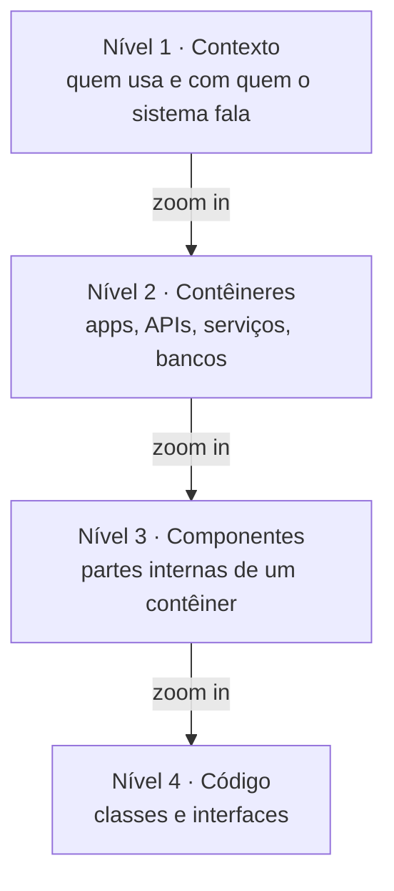
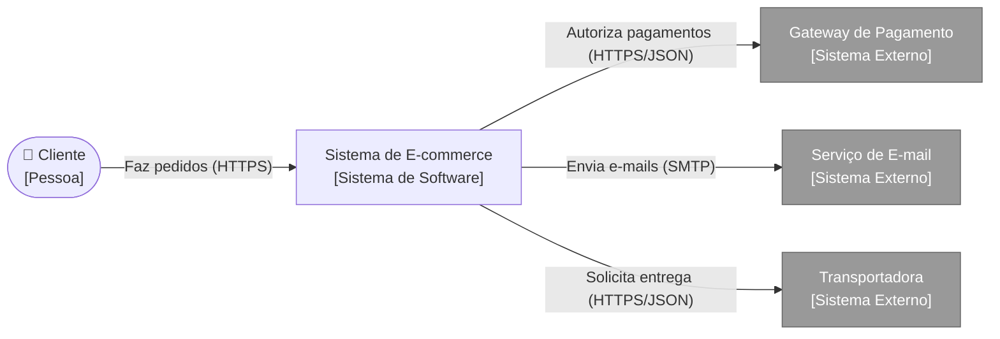
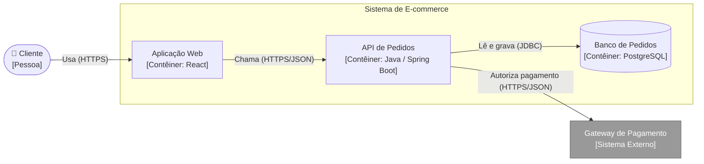
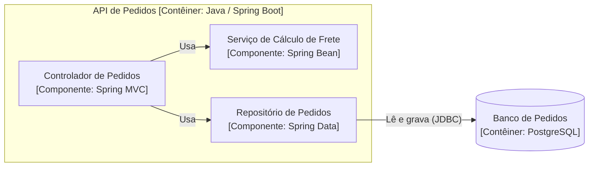
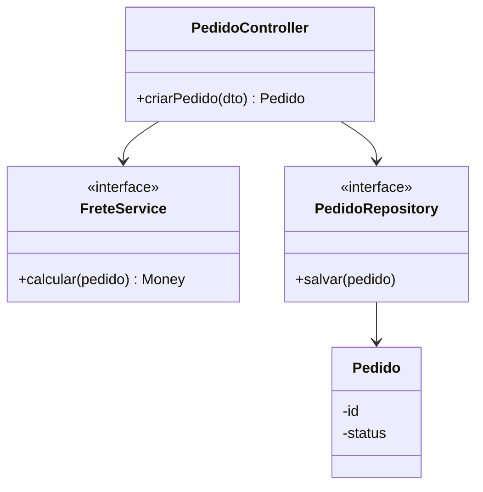
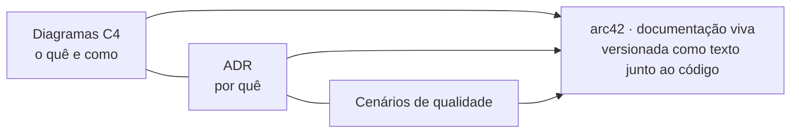

# Aula 4 — UML: C4 Model, Documentação e Comunicação da Arquitetura

> **Curso:** Arquitetura de Sistemas e Microsserviços · Unidade 1 · Aula 4 — Prof. Nataniel Paiva

Documentação de um sistema de **e-commerce** nos **quatro níveis do C4 Model**, com diagramas suplementares, ADRs e a ideia de **documentação viva** (diagramas como texto, versionados com o código).

## Os quatro níveis de zoom

## Nível × público

| Nível | Diagrama | Público | Documento |
|---|---|---|---|
| 1 | Contexto | Negócio, diretoria, clientes | [02](docs/02-c4-nivel1-contexto.md) |
| 2 | Contêineres | Arquitetos, líderes técnicos, novos devs | [03](docs/03-c4-nivel2-conteineres.md) |
| 3 | Componentes *(opcional)* | Devs do contêiner | [04](docs/04-c4-nivel3-componentes.md) |
| 4 | Código *(opcional)* | Devs do contêiner | [05](docs/05-c4-nivel4-codigo.md) |

## Nível 1 — Contexto

## Nível 2 — Contêineres

## Nível 3 — Componentes (API de Pedidos)

## Nível 4 — Código

## C4 = o quê/como · ADR = por quê · arc42

## Conteúdo

- [`docs/`](docs/) — um documento por tema (01 a 08), com versões C4 nativas do Mermaid e alternativas em `flowchart`.
- [`diagramas/`](diagramas/) — fontes `.mmd`, um por diagrama.
- [`adr/`](adr/) — ADRs de exemplo ligados aos diagramas.
- [`structurizr/workspace.dsl`](structurizr/workspace.dsl) — mesma arquitetura em Structurizr DSL *(exemplo adicional)*.
- [`glossario.md`](glossario.md)

> Os ADRs, a Transportadora e o Structurizr DSL são *exemplos adicionais*, fora dos slides.
> Fonte: Aula 4 — Prof. Nataniel Paiva.
