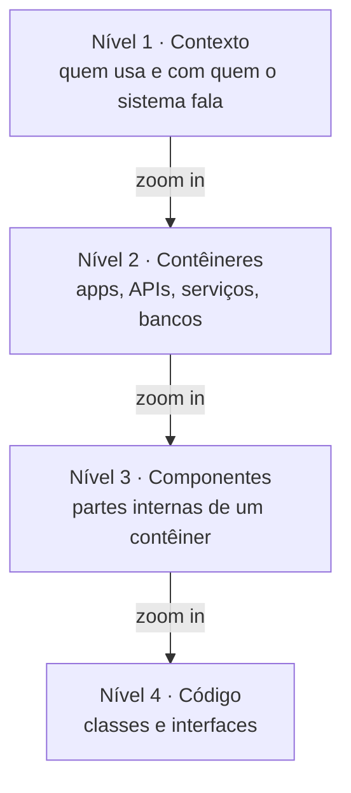

# 01 — Limitações da UML para a visão macro

> Aula 4 — Prof. Nataniel Paiva

A UML detalha **estrutura e comportamento no nível do código**, mas não responde bem à pergunta:

> *"De que sistemas essa aplicação é composta e como eles se conectam?"*

- Não define notação padrão para a visão macro (sistemas, serviços, bancos de dados).
- Não define uma forma de **navegar do geral ao código**.
- Resultado: times criam diagramas *ad hoc* — retângulos e setas **sem significado padronizado**.

## A resposta: C4 Model (Simon Brown)

Notação simples (4 tipos de diagrama, poucos elementos) que **complementa — não substitui — a UML**. A ideia central é o **zoom**, como um mapa: país → estado → cidade → rua.

Fonte: [`diagramas/05-niveis-de-zoom.mmd`](../diagramas/05-niveis-de-zoom.mmd)

Próximo: [Nível 1 — Contexto](02-c4-nivel1-contexto.md)
