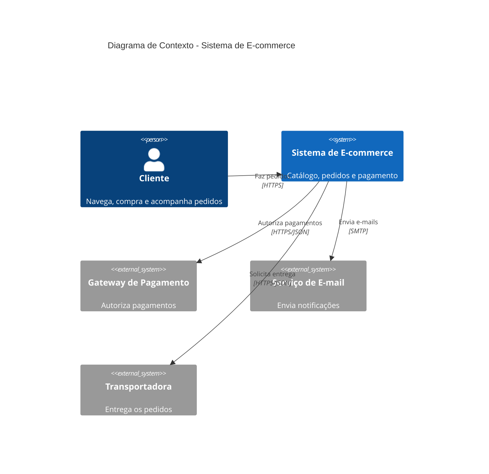
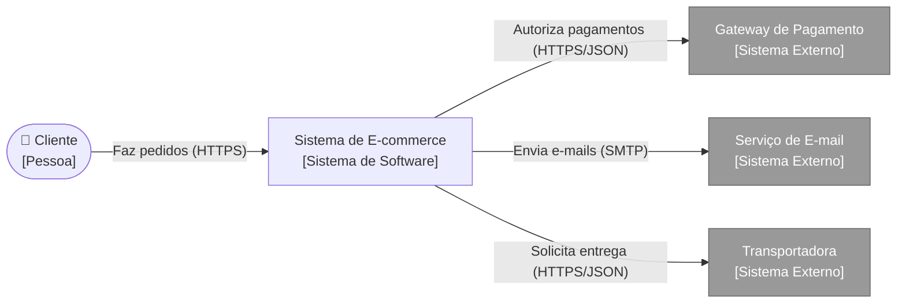

# 02 — C4 Nível 1: Contexto

O sistema é uma **caixa preta**, cercado por pessoas e sistemas externos.

- **Público:** negócio, diretoria, clientes, pessoas não técnicas.
- **Pergunta respondida:** quem usa o sistema e com quais sistemas ele conversa?

## Diagrama (C4Context)

## Alternativa em flowchart (externos em cinza)

Fontes: [`01-contexto.mmd`](../diagramas/01-contexto.mmd), [`01-contexto-flowchart.mmd`](../diagramas/01-contexto-flowchart.mmd)

> *Exemplo adicional:* a Transportadora como sistema externo não consta nos slides.

Decisão relacionada: [ADR-0001](../adr/0001-gateway-de-pagamento-externo.md)

Próximo: [Nível 2 — Contêineres](03-c4-nivel2-conteineres.md)
