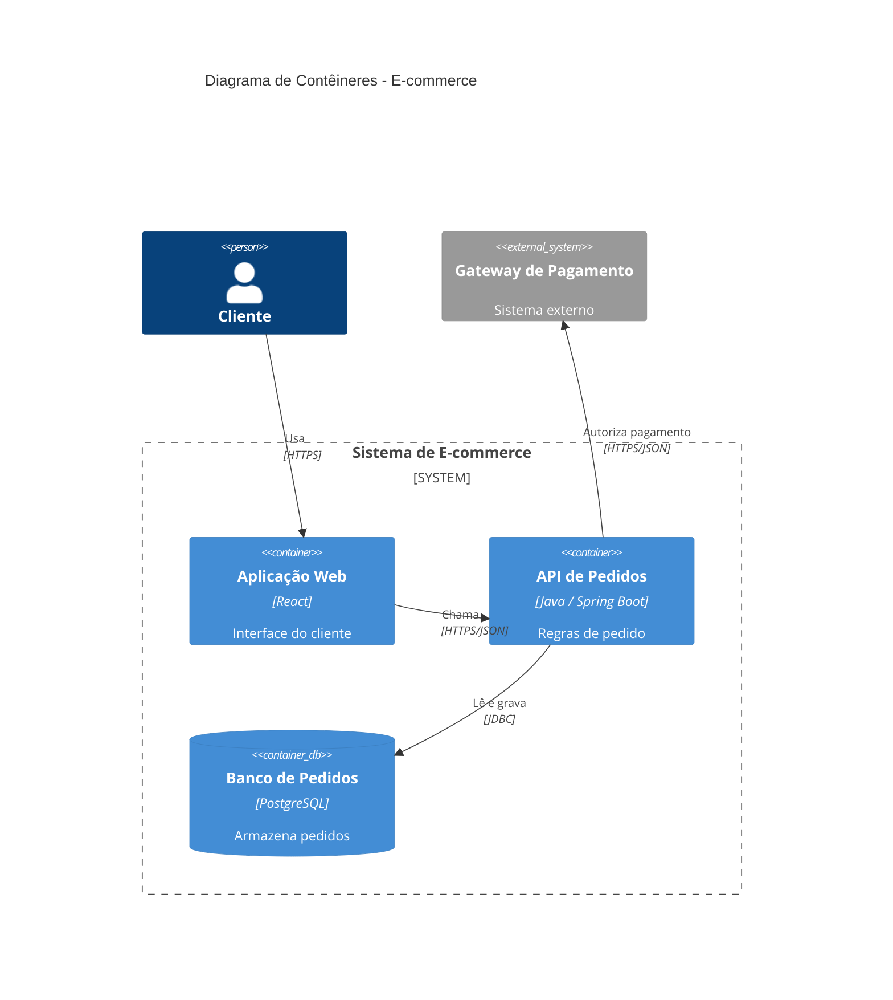
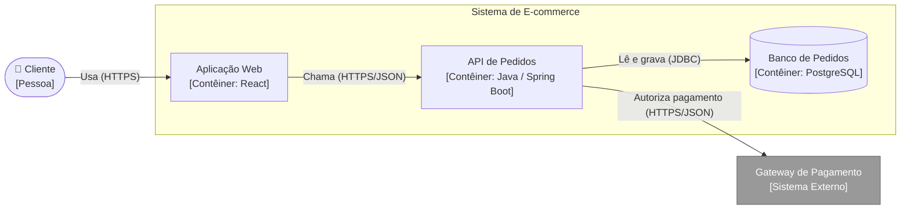

# 03 — C4 Nível 2: Contêineres

Mostra as **unidades implantáveis ou de armazenamento**: aplicação web, API, serviço, banco, app móvel.

> ⚠️ **Contêiner C4 ≠ contêiner Docker.** Pode incluir um contêiner Docker, mas não se limita a isso.

- **Público:** arquitetos, líderes técnicos, novos desenvolvedores.

## Diagrama (C4Container)

## Alternativa em flowchart

Fontes: [`02-conteineres.mmd`](../diagramas/02-conteineres.mmd), [`02-conteineres-flowchart.mmd`](../diagramas/02-conteineres-flowchart.mmd)

Decisão relacionada: [ADR-0002](../adr/0002-api-de-pedidos-com-spring-boot.md)

Anterior: [Nível 1](02-c4-nivel1-contexto.md) · Próximo: [Nível 3](04-c4-nivel3-componentes.md)
