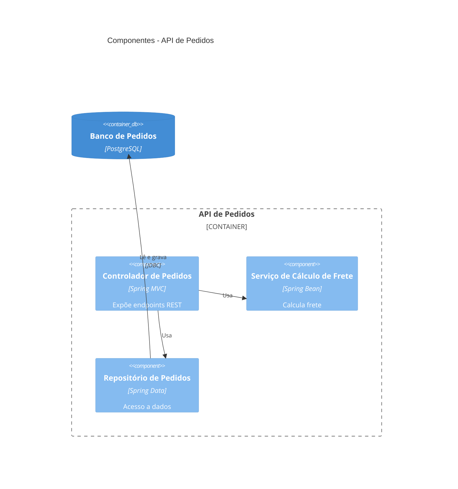
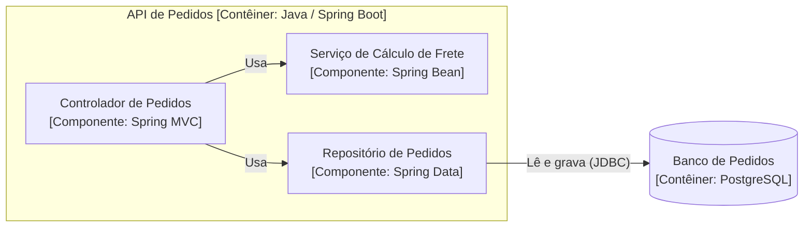

# 04 — C4 Nível 3: Componentes *(opcional)*

Mostra os componentes internos de **um** contêiner e suas responsabilidades. É **opcional**: use apenas para os contêineres mais complexos — aqui, a **API de Pedidos**.

- **Público:** desenvolvedores do contêiner.

## Diagrama (C4Component)

## Alternativa em flowchart

Fontes: [`03-componentes.mmd`](../diagramas/03-componentes.mmd), [`03-componentes-flowchart.mmd`](../diagramas/03-componentes-flowchart.mmd)

Anterior: [Nível 2](03-c4-nivel2-conteineres.md) · Próximo: [Nível 4](05-c4-nivel4-codigo.md)
