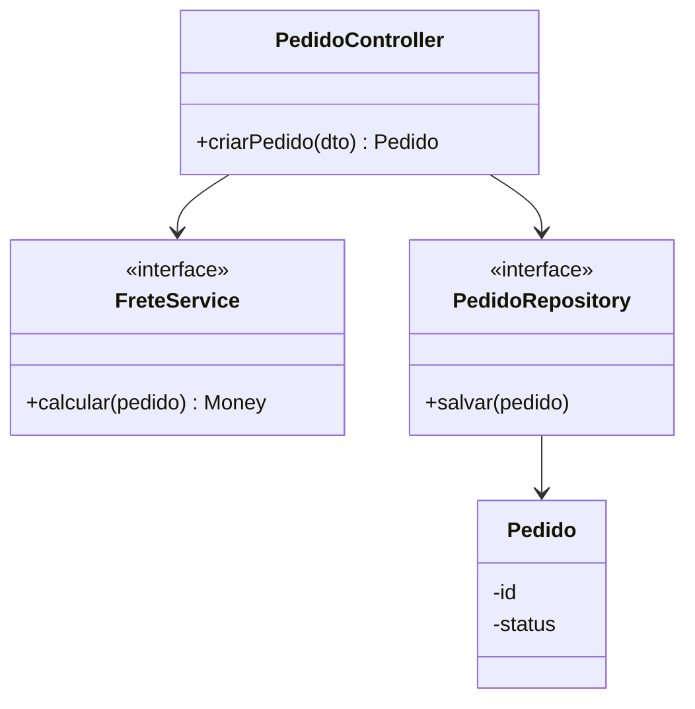

# 05 — C4 Nível 4: Código *(opcional)*

Classes e interfaces com suas relações — aqui o C4 **encontra o diagrama de classes da UML**.

> Gere este nível **só se necessário** e, idealmente, **automatizado a partir do código** (para não ficar obsoleto).

- **Público:** desenvolvedores do contêiner.

Fonte: [`04-codigo.mmd`](../diagramas/04-codigo.mmd)

Anterior: [Nível 3](04-c4-nivel3-componentes.md) · Próximo: [Notação e boas práticas](06-notacao-e-boas-praticas.md)
