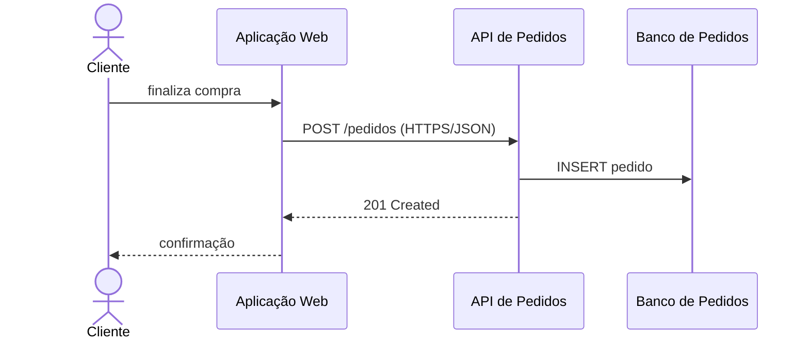
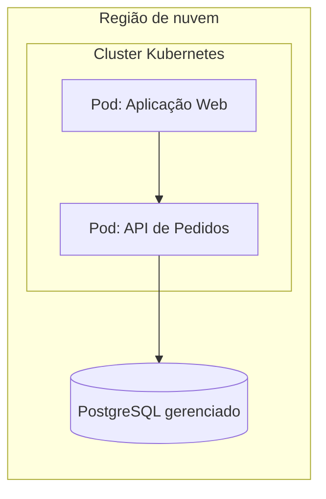

# 07 — Diagramas suplementares

## Diagrama dinâmico

Mostra a **colaboração entre contêineres/componentes** em um cenário (≈ diagrama de sequência da UML). Cenário: finalizar uma compra.

Fonte: [`06-dinamico.mmd`](../diagramas/06-dinamico.mmd)

## Diagrama de implantação (deployment)

Mapeia os contêineres para a **infraestrutura real**: servidores, regiões de nuvem, clusters Docker/Kubernetes. Aprofundado na **Unidade 3**.

Fonte: [`07-implantacao.mmd`](../diagramas/07-implantacao.mmd)

Anterior: [Notação](06-notacao-e-boas-praticas.md) · Próximo: [Comunicação por público](08-comunicacao-por-publico.md)
