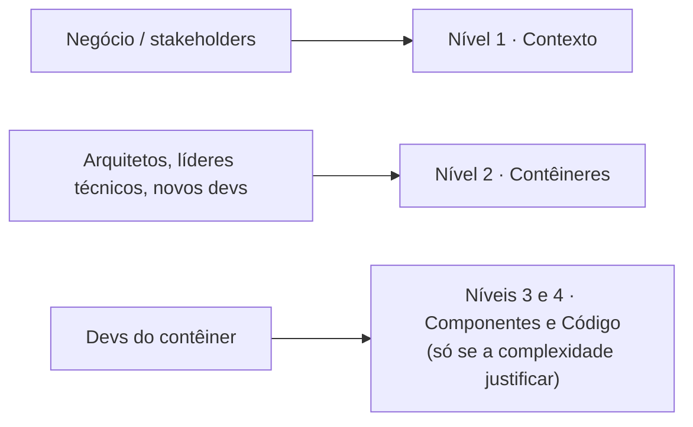

# 08 — Comunicação por público e documentação viva

## Qual nível para qual público

| Nível | Diagrama | Público |
|---|---|---|
| 1 | Contexto | Negócio, diretoria, clientes, não técnicos |
| 2 | Contêineres | Arquitetos, líderes técnicos, novos devs |
| 3 | Componentes *(opcional)* | Devs do contêiner |
| 4 | Código *(opcional, automatizado)* | Devs do contêiner |

## Documentação viva: C4 + ADR + arc42

- **C4** mostra **o quê** e **como**; o **ADR** explica **por quê**.
- Versione diagramas e ADRs **junto ao código, como texto**.
- **arc42** sugere combinar visões estruturais (C4/UML) + decisões (ADR) + cenários de qualidade.

## Ligação diagramas ↔ ADR

| Diagrama | ADR |
|---|---|
| [Contexto](02-c4-nivel1-contexto.md) | [ADR-0001 — Gateway de pagamento externo](../adr/0001-gateway-de-pagamento-externo.md) |
| [Contêineres](03-c4-nivel2-conteineres.md) | [ADR-0002 — API de Pedidos com Spring Boot](../adr/0002-api-de-pedidos-com-spring-boot.md) |

Anterior: [Diagramas suplementares](07-diagramas-suplementares.md)
