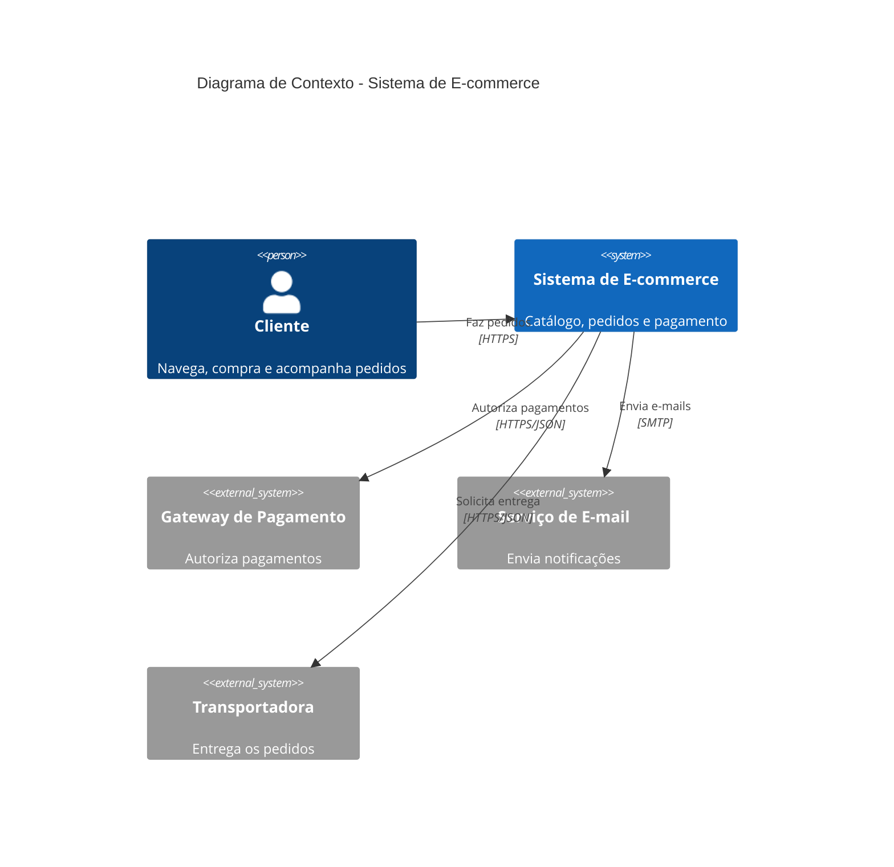
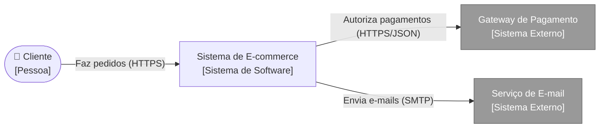
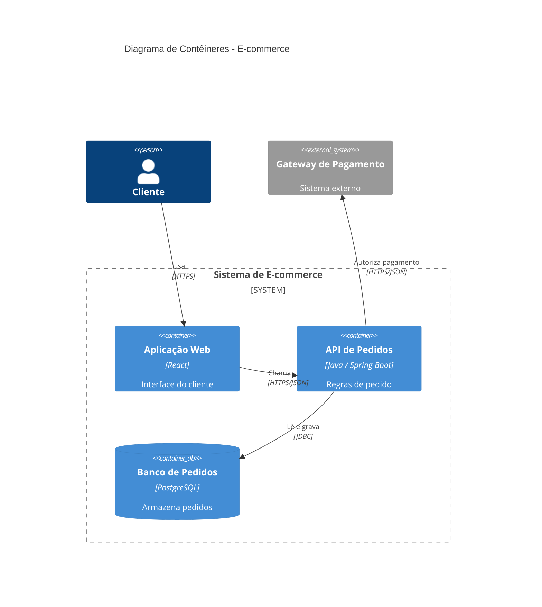
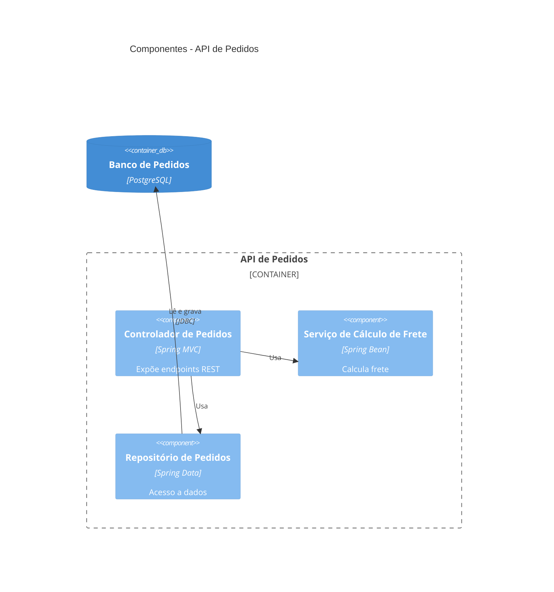
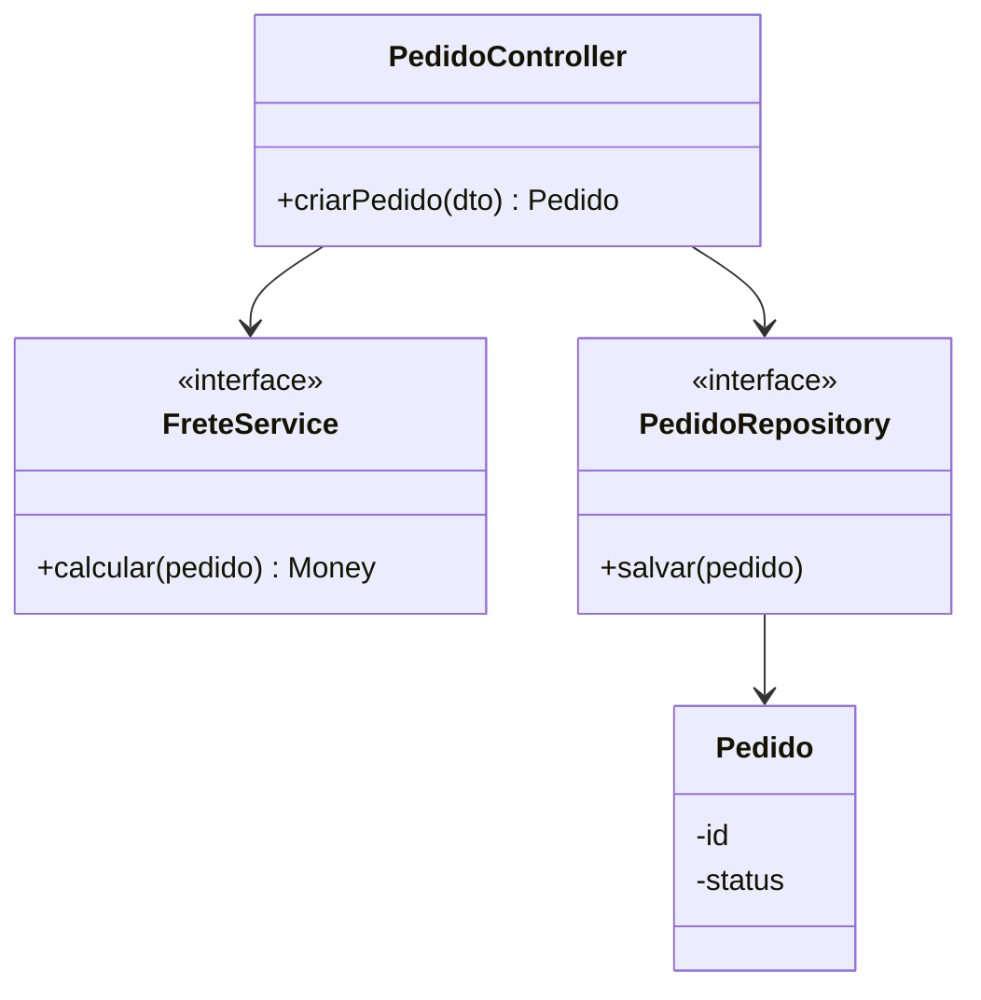
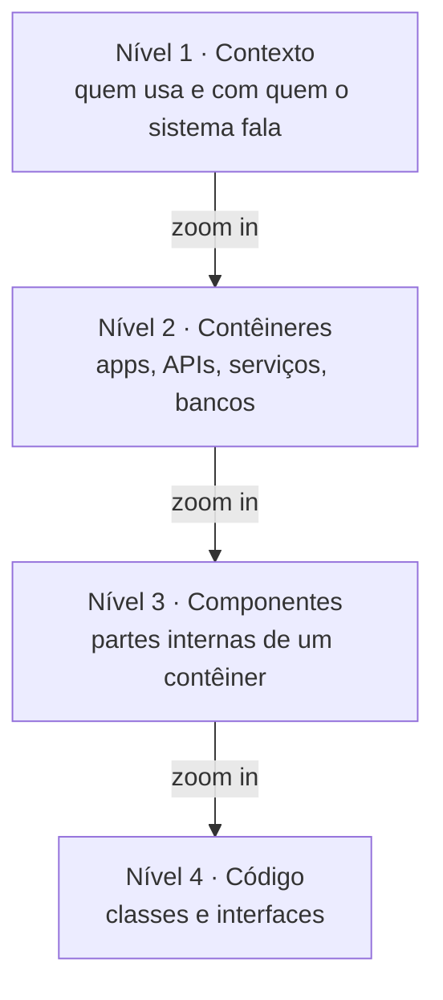
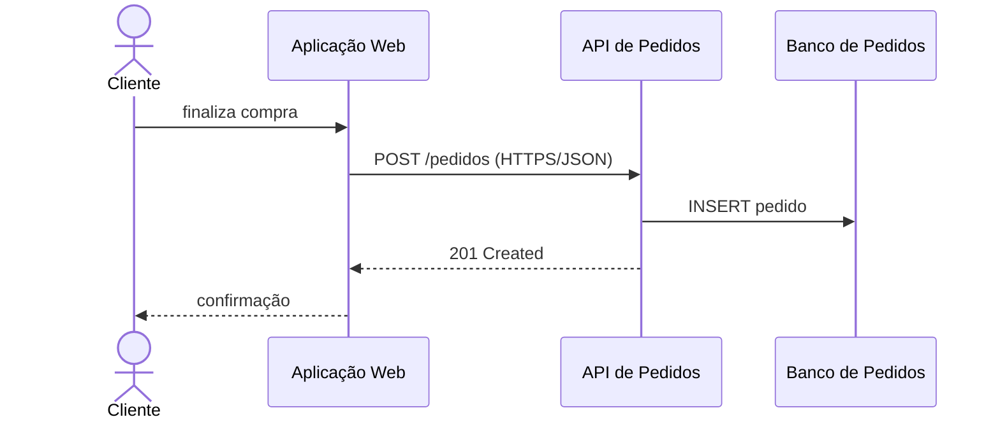
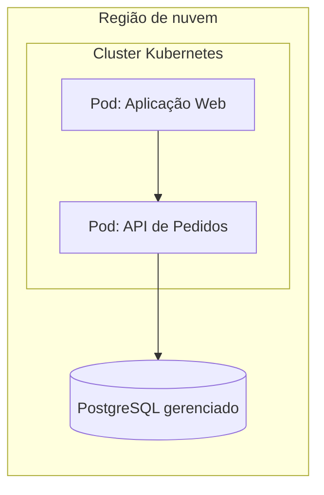
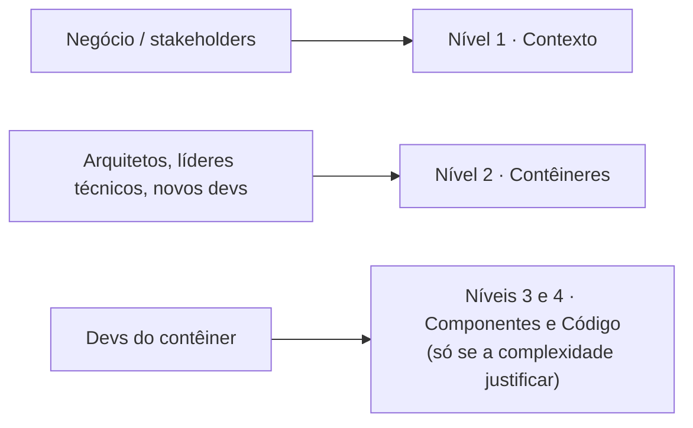
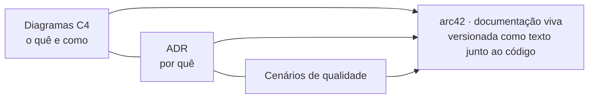

# Aula 4 — UML: C4 Model, Documentação e Comunicação da Arquitetura

> **Curso:** Arquitetura de Sistemas e Microsserviços · **Unidade 1 · Aula 4** · Prof. Nataniel Paiva
> **Fonte:** `Aula4_..._UML C4 Model, Documentação e Comunicação da Arquitetura_unidade01_aula04.pptx` (36 slides)

Este README é um **briefing para outra IA** criar um projeto visual sobre o C4 Model e a comunicação da arquitetura. O conteúdo vem dos slides; os diagramas Mermaid são **exemplos prontos** para renderizar no GitHub.

---

## 1. Objetivo do projeto a ser gerado

Um repositório que documente um sistema de exemplo (e-commerce) **nos quatro níveis do C4**, mais diagramas suplementares, com a regra de "qual nível mostrar para qual público" e a ideia de **documentação viva** (diagramas como texto, versionados com o código).

**Idioma:** PT-BR. **Tom:** didático, com exemplos visuais.

## 2. Resumo do conteúdo (fonte de verdade)

### 2.1 O problema
UML detalha estrutura e comportamento no nível do código, mas não responde bem: *"de que sistemas essa aplicação é composta e como eles se conectam?"* Não define notação padrão para a visão macro (sistemas, serviços, bancos) nem para navegar do geral ao código. Times acabam criando diagramas ad hoc (retângulos e setas sem significado padronizado).

### 2.2 C4 Model (Simon Brown)
Notação simples (4 tipos de diagrama, poucos elementos) que **complementa — não substitui — a UML**. Ideia central: **zoom**, como um mapa (país → estado → cidade → rua).

| Nível | Diagrama | O que mostra | Público |
|---|---|---|---|
| 1 | **Contexto** | sistema como "caixa preta" + pessoas e sistemas externos | negócio, diretoria, clientes, não técnicos |
| 2 | **Contêineres** | unidades implantáveis/armazenamento: web app, API, serviço, banco, app móvel (não é só Docker) | arquitetos, líderes técnicos, novos devs |
| 3 | **Componentes** | componentes internos de **um** contêiner e responsabilidades; **opcional**, só para os mais complexos | devs do contêiner |
| 4 | **Código** | classes/interfaces e relações (encontra o diagrama de classes UML); gerar **só se necessário e automatizado** | devs do contêiner |

### 2.3 Notação
- Elementos com rótulo de tipo entre colchetes: `[Pessoa]`, `[Sistema de Software]` / `[Sistema Externo]`, `[Contêiner: tecnologia]`, `[Componente: tecnologia]`.
- **Setas rotuladas** com relacionamento e, idealmente, protocolo/tecnologia (`HTTPS/JSON`, `gRPC`).
- Diferenciar **sistemas externos** (em cinza) dos internos mostra onde termina a responsabilidade do time.

### 2.4 Diagramas suplementares
- **Dinâmico:** colaboração entre contêineres/componentes em um cenário (≈ diagrama de sequência).
- **Implantação (deployment):** contêineres → infraestrutura real (servidores, regiões de nuvem, clusters Docker/Kubernetes) — aprofundado na Unidade 3.

### 2.5 Documentação viva: C4 + ADR + arc42
- C4 mostra **"o quê" e "como"**; ADR explica **"por quê"**.
- Versionar diagramas e ADR **junto ao código, como texto** (Structurizr, **Mermaid**, PlantUML) — evitar imagens estáticas que ficam obsoletas.
- **arc42** sugere combinar: visões estruturais (C4/UML) + decisões (ADR) + cenários de qualidade.

---

## 3. Exemplos Mermaid (renderizam no GitHub)

> O GitHub suporta a sintaxe `C4Context`/`C4Container`/`C4Component` do Mermaid (marcada como experimental). Se algum não renderizar na versão do Mermaid em uso, use a **alternativa em flowchart** logo abaixo de cada um.

### 3.1 Nível 1 — Contexto (Figura 8)



Alternativa em flowchart (sistemas externos em cinza):



### 3.2 Nível 2 — Contêineres



### 3.3 Nível 3 — Componentes (dentro da API de Pedidos)



### 3.4 Nível 4 — Código (encontra a UML de classes)



### 3.5 Os quatro níveis de zoom (Figura 9)



### 3.6 Diagrama dinâmico (equivale à sequência)



### 3.7 Diagrama de implantação (alternativa em flowchart)



### 3.8 Qual nível para qual público



### 3.9 Documentação viva



---

## 4. Estrutura sugerida do projeto a gerar

```
aula4-projeto/
├── README.md                     # visão geral + os 4 níveis embutidos
├── docs/
│   ├── 01-limitacoes-da-uml.md
│   ├── 02-c4-nivel1-contexto.md
│   ├── 03-c4-nivel2-conteineres.md
│   ├── 04-c4-nivel3-componentes.md
│   ├── 05-c4-nivel4-codigo.md
│   ├── 06-notacao-e-boas-praticas.md
│   ├── 07-diagramas-suplementares.md
│   └── 08-comunicacao-por-publico.md
├── diagramas/                    # .mmd fonte (um por diagrama)
├── adr/                          # exemplo de ADR ligado aos diagramas
├── structurizr/ ou plantuml/     # (opcional) mesma arquitetura em outra ferramenta
└── glossario.md
```

## 5. Regras para a IA que for gerar o projeto

1. **Mesmo sistema de exemplo em todos os níveis** (e-commerce), para o leitor "dar zoom" de verdade.
2. **Rotule tudo:** tipo entre colchetes e **protocolo nas setas**; destaque sistemas externos em cinza.
3. **Mermaid:** ```` ```mermaid ````; para C4 testar renderização e manter a alternativa em `flowchart`.
4. **Nível 3 e 4 são opcionais** — diga isso e mostre-os só para o contêiner mais complexo; nível 4 idealmente gerado do código.
5. **Diagramas como texto** (`.mmd`) versionados — nunca só imagem estática.
6. Não confundir "contêiner" do C4 com contêiner Docker (pode incluir, mas não se limita).
7. Incluir tabela **nível × público** e link entre diagramas e ADR.
8. Marcar como *"exemplo adicional"* o que não está nos slides. Citar: *Aula 4 — Prof. Nataniel Paiva*.

## 6. Checklist de aceitação

- [ ] Os 4 níveis do C4 para o mesmo sistema
- [ ] Setas com protocolo; externos em cinza
- [ ] Diagrama dinâmico e de implantação
- [ ] Tabela de público por nível
- [ ] Seção "C4 = o quê/como · ADR = por quê · arc42"
- [ ] Renderização validada no GitHub
